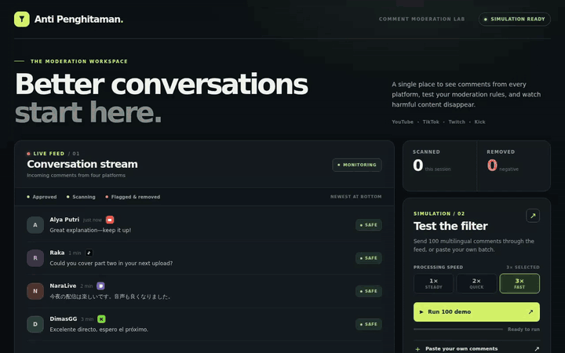

# Negative comment classification API

A small HTTP API that decides whether a comment or a piece of text is negative. The client doesn't send an API key; the server holds `OPENROUTER_API_KEY` and calls the OpenRouter Decisions API with a decision model (Jev by default — switch it in the UI or per request).

There's a simulation UI at `http://localhost:3001`. The feed pulls comments from YouTube, TikTok, Twitch, and Kick, and each comment shows a logo for the platform it came from. Send a comment to watch it get classified. Negative ones get flagged and destroyed with an animation. The demo ships 100 comments across a dozen languages. **Paste bulk** takes up to 20 comments at once, one per line. **Speed** sets the parallelism for the demo and bulk runs (1×, 2×, 3×; 3× by default). The **Negative threshold** slider controls how sensitive the classifier is, and the **Decision model** field picks which model answers (type any id, or choose from the list).

## Demo

Short GIF of the moderation flow (paste a batch of comments → classify → negative ones get destroyed):



Full-quality video: [`docs/demo.mp4`](docs/demo.mp4)

## Running it

Needs Node.js 22.18 or newer.

```bash
npm install
cp .env.example .env
# put your OPENROUTER_API_KEY in .env
npm run dev
```

For production:

```bash
npm run build
npm start
```

## Endpoints

### `POST /classify`

No API key header needed from the client.

```bash
curl http://localhost:3001/classify \
  -H 'Content-Type: application/json' \
  -d '{"text":"Pelayanannya buruk dan sangat mengecewakan"}'
```

Body:

- `text` (required): the comment to classify.
- `threshold` (optional): 0–1, overrides `NEGATIVE_THRESHOLD`.
- `model` (optional): any OpenRouter decision model id, e.g. `~typesafe/jev-latest`, `cloudflare/clef-flash`, or `microsoft/microsoft-decision-1`. Falls back to `DECISION_MODEL` (default `~typesafe/jev-latest`).

Example response:

```json
{
  "negative": true,
  "score": 0.99,
  "confidence": 0.99,
  "model": "typesafe/jev-1.13-20260917"
}
```

- `score`: how likely the text is negative, from 0 to 1.
- `negative`: `true` when `score >= NEGATIVE_THRESHOLD` (default `0.5`).
- `confidence`: how sure the model is about the boolean it picked.
- `model`: the concrete model that answered (an alias resolves to its pinned release).

### `GET /models`

Lists the decision models the app knows about, plus the current default. There are ~22 decision models on OpenRouter across TypeSafe (Jev), Cloudflare (Clef), Microsoft, [OI] (GPT-6 Luna), Perplexity, Nace.AI, Liquid, Upstage, Inception, ScaleDown, Together, and a few community ones. The `/classify` `model` field still accepts any id, listed or not.

```bash
curl http://localhost:3001/models
```

```json
{
  "default": "~typesafe/jev-latest",
  "models": [
    { "id": "~typesafe/jev-latest", "label": "TypeSafe · Jev Latest", "note": "Newest Jev release (alias)" },
    { "id": "cloudflare/clef-flash", "label": "Cloudflare · Clef Flash", "note": "Fast 9B, low latency" },
    { "id": "microsoft/microsoft-decision-1", "label": "Microsoft · Decision-1", "note": "Qwen3.5-9B post-train" },
    { "id": "openai/gpt-6-luna-decisions", "label": "[OI] · GPT-6 Luna Decisions", "note": "Hosted Decisions API" }
  ]
}
```

### `GET /health`

Returns `{ "ok": true }` without calling OpenRouter.

## Live comment integration

Pull comments straight from a platform's live chat. Read-only, no API key.

### `GET /live/stream` (SSE)

```bash
curl -N 'http://localhost:3001/live/stream?platform=twitch&channel=nix'
```

- `platform`: `twitch` | `kick` | `youtube` | `tiktok`
- `channel`: username / slug / handle on that platform
- `video` (optional, YouTube): a live video id, to skip the channel lookup

Events it sends:

```
event: status
data: {"state":"connecting","platform":"twitch","channel":"nix"}

event: status
data: {"state":"open"}

event: comment
data: {"platform":"twitch","channel":"nix","id":"…","author":"ggadki","text":"!турнир","at":"2026-10-13T15:13:20.902Z"}

event: error
data: {"message":"…"}
```

You can also test an adapter straight from the terminal (no server):

```bash
npm run live -- twitch nix
npm run live -- kick tjr
npm run live -- youtube LofiGirl 1-LpQekNa9g
npm run live -- tiktok <username-currently-live>
```

Per-platform notes (all read-only, no key):

- **Twitch**: `tmi.js` (IRC). The most stable of the four.
- **Kick**: Kick's Centrifugo realtime (`web.kick.com/api/v1/realtime` + websocket). Unofficial, so it can break anytime.
- **YouTube**: `youtubei.js` (innertube). Needs a stream that's live with chat on; the most fragile.
- **TikTok**: `tiktok-live-connector`. Needs an account that's currently LIVE (and TikTok's signature).

Adapters live in `src/sources/`, one file per platform, with `src/sources/index.ts` as the registry. Both the SSE endpoint in `src/server.ts` and the CLI in `src/sources/cli.ts` use it.

## Security

`.env` is gitignored. Don't put the OpenRouter key in source or send it from the client. The endpoint deliberately has no auth for this use case; before you expose it to the internet, add rate limiting or auth first so nobody burns your OpenRouter credits.
